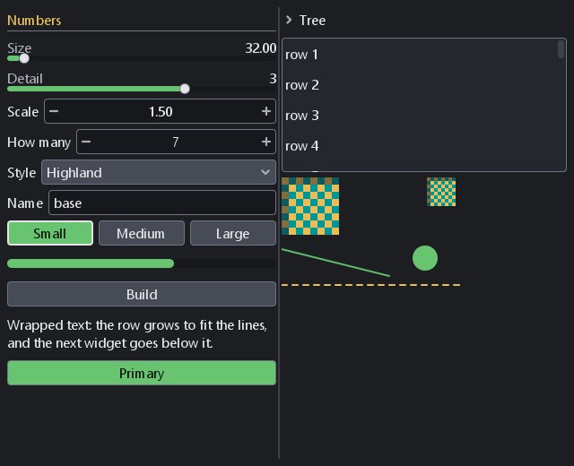
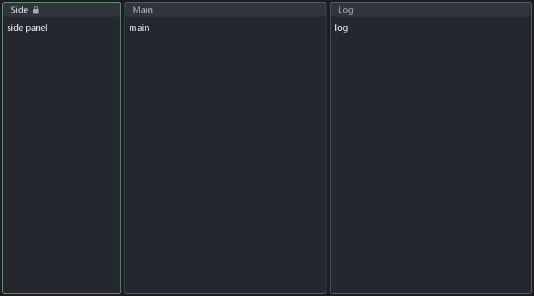
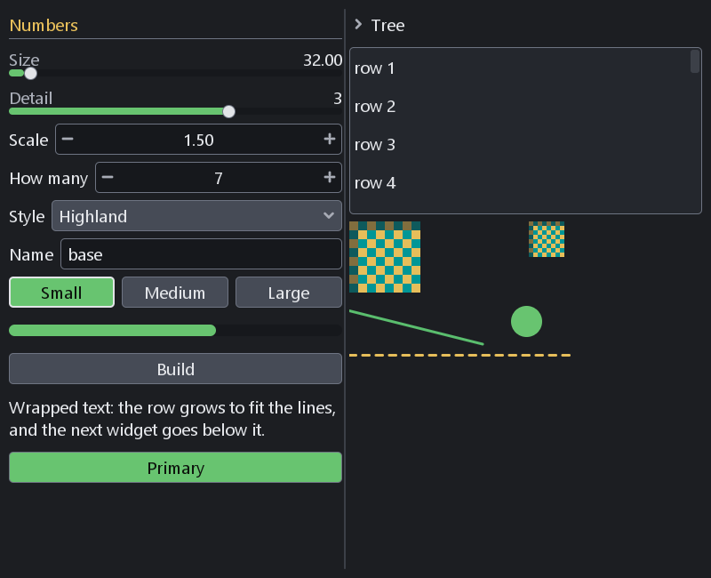
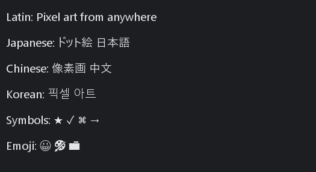
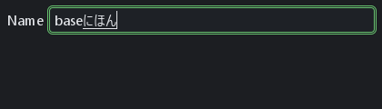
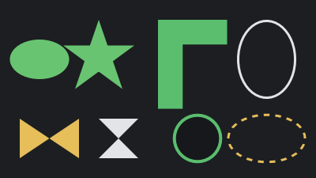
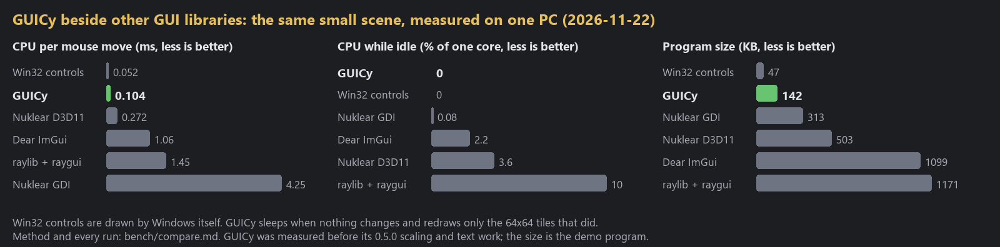

# GUICy

An immediate-mode GUI library for Windows in **one C header**. It draws with its own CPU renderer
(scalar, SSE2 and AVX2 versions that give the same bytes), redraws only the 64x64 tiles that changed,
and uses **no CPU at all** while nothing happens. It needs nothing but Windows itself: link GDI32 and
USER32, and the program is one exe.



```c
#define GUICY_IMPLEMENTATION
#include "guicy.h"

int main(void) {
    int clicks = 0;
    if (!gy_open(&(gy_desc){ .title = "Hello", .w = 320, .h = 120 })) return 1;
    while (gy_frame()) {                       /* sleeps until something happens */
        gy_text("Clicked %d times", clicks);
        if (gy_button("Click me")) clicks++;
    }
    gy_shutdown();
    return 0;
}
```

```
clang -O2 hello.c -lgdi32 -luser32        (or gcc)
```

Version 0.5.0. **Feature freeze:** no new features for now; bug fixes only.

## What is in it

- **Widgets:** text and wrapped text, buttons, check boxes, choices and chips, sliders, number
  boxes, edit boxes (selection, clipboard, undo), combo boxes, trees, progress bars, tooltips,
  right-click menus, popups, scroll regions, split panes, images, and a canvas for lines, dashes,
  rectangles, circles, ellipses and filled polygons.
- **Tiling:** each part of a tool lives in its own tile. Tiles split, stack as tabs, swap, grow,
  zoom and close with Alt keys or the mouse, and the layout saves as one line for an ini file.
- **Developer locks:** a rule pins a tile to a side of the window at a fixed size, and locks can stop
  the user moving, resizing, closing or stacking it. A lock can't be undone by the user: not by key,
  click or a hand-edited saved line. Only a window too small for the locked sizes, even after GUICy
  shrinks its own scale to 75 %, makes them give way, and they come back when the window grows.

  

- **Scaling:** every size is in font units, so the whole UI follows the monitor's DPI, the screen's
  resolution, the font size and Ctrl+= / Ctrl+- / Ctrl+wheel zoom, the way VS Code does. It works per
  monitor, and follows Windows' high contrast mode.

  

- **Any script:** a character the font lacks comes from the first of Windows' own fonts that has it
  (Japanese, Chinese, Korean, symbols, emoji in one colour). GUICy reads the fonts' character tables
  itself, so the look stays GDI's.

  

- **IME:** Japanese, Chinese and Korean input. The text being composed is drawn underlined at the
  caret, and the candidate list opens below it.

  

- **Keyboard:** Tab and Shift+Tab walk every widget, Enter or Space presses the focused one, and
  arrows step sliders and numbers. The focus outline shows only after a Tab.
- **Long labels** are cut with "…", and the whole text shows as a tooltip.

  

## Speed and size



The same small scene in each library, built with the same compiler and measured on one PC: three
runs each, medians. The method and every run are in [bench/compare.md](bench/compare.md), and
GUICy's own step-by-step numbers are in [BENCH.md](BENCH.md).

The library alone is about 124 kB of code and data (`guicy.o`, clang -O2).

## Building and testing

- Built and tested with clang 23 (MinGW target) and MinGW gcc 16, at `-Wall -Wextra -Werror`. MSVC is
  not tested yet.
- `build.cmd` builds the tests, the demo and the benchmarks into `build\`. It expects an LLVM setup
  script; see the top of the file.
- `build\gytest.exe` runs 69 tests off screen. Each draws its picture with all three pixel kernels,
  which must agree byte for byte, and compares a hash against `tests/golden/hashes.txt` (PNGs for
  people sit beside it). `gytest --windowed` runs 5 more with real windows on a desktop of its own, so
  they never take your focus.

## Not in this version

- A GPU renderer. The plan is a mixed one, where each kind of frame goes to whichever of the GPU and
  the CPU measures faster on that machine; it waits for the feature freeze to lift.
- A second top-level window.
- Colour emoji, and right-to-left or complex-script shaping.
- Anything but Windows.

## Licence

MIT: see [LICENSE](LICENSE).
